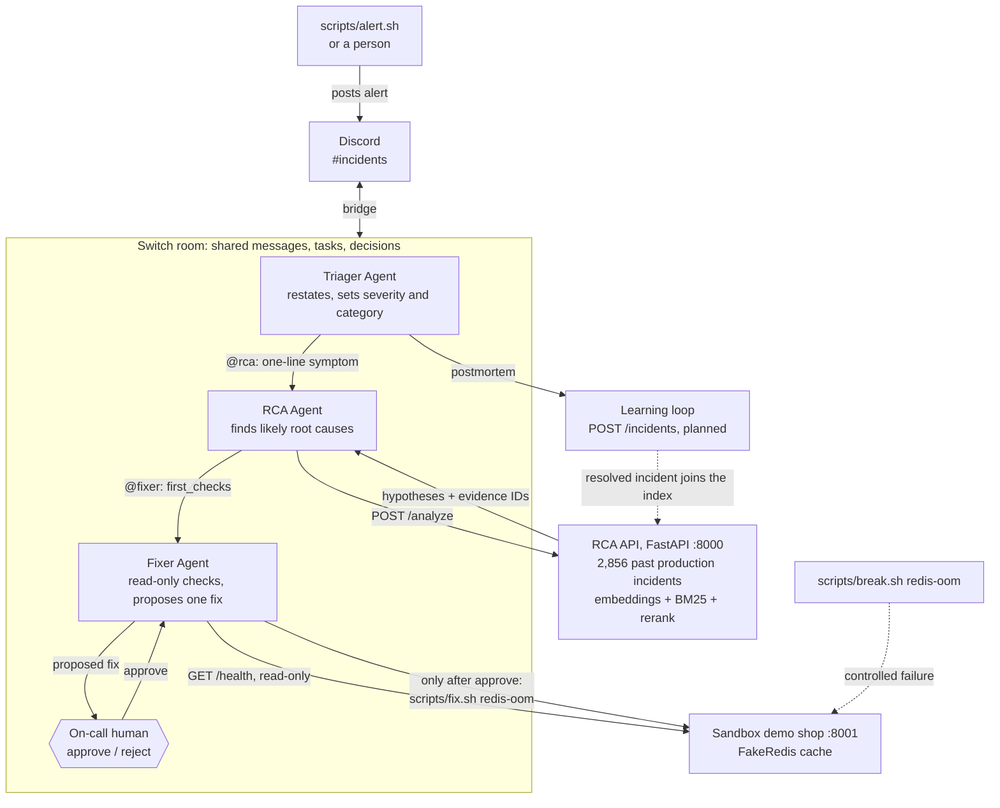

# Architecture

## Incident flow

1. **Alert.** `scripts/alert.sh` runs a synthetic checkout. If it fails, the script prints an alert, and a person posts it in the incident channel.
2. **Triage.** The channel is bridged to a Switch room. The Triager restates the alert in one line, sets severity and category, and hands it to the RCA Agent by @mention.
3. **Root cause.** The RCA Agent calls `POST /analyze`, which searches 2,856 past production incidents. It posts the top hypotheses with evidence IDs and source links, then hands `first_checks` to the Fixer.
4. **Checks.** The Fixer runs read-only checks against the sandbox shop, pastes the exact output, and proposes one fix as an exact command.
5. **Approval.** Nothing changes until a human in the room replies "approve". Only then does the Fixer run `scripts/fix.sh redis-oom`, which re-checks checkout and health.
6. **Learning loop.** The Triager writes the postmortem and records the decision. The resolved incident is added to the RCA index, so the next similar alert can cite it. *(Planned.)*

## Components

| Component | Location | Port |
|---|---|---|
| RCA API | `Backend/` | 8000 |
| Sandbox demo shop | `demo-shop/` | 8001 |
| Break, fix and alert scripts | `scripts/` | n/a |
| Switch room and agents | Switch | n/a |

## Safety

- Fixes are applied only after a human approves in the room.
- Failures are simulated only in the local sandbox. Every script refuses to run unless `SHOP_URL` points at localhost.
